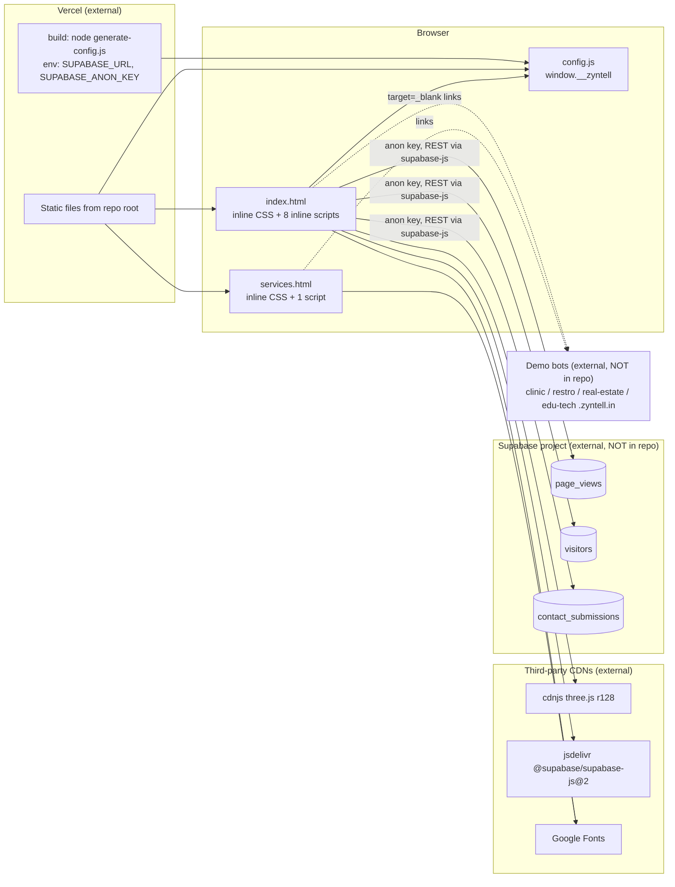
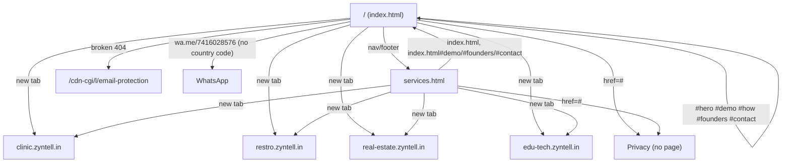
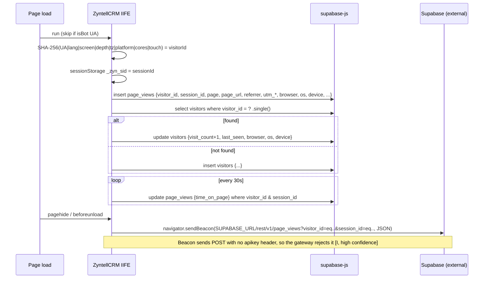
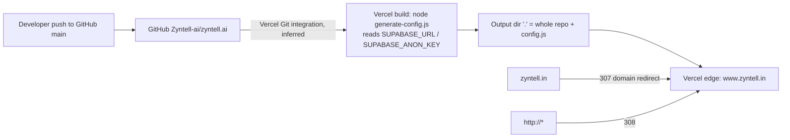

# Zyntell Website — Technical Audit

- **Audit date:** 2026-10-24
- **Repository:** `Zyntell-ai/zyntell.ai` (local folder `Zyntellsite/`)
- **Commit audited:** `ab6bbcc` on `main` (working tree clean, up to date with `origin/main`)
- **Scope:** Every file tracked in the repo (10 files). Nothing outside `Zyntellsite/` was inspected.
- **Mode:** Read-only. This report is the only file created. No dependencies were installed. Nothing was written to production.

Evidence labels used throughout:
- **[V] Verified**: read in source, or observed with a read-only HTTP request to the live site.
- **[I] Inference**: reasonable conclusion that was not directly proven.
- **[U] Unknown**: cannot be determined from this repo (for example, Supabase database policies).

---

## 1. Executive Summary

- **What it is.** The repo is the **public marketing website** for ZYNTELL: two hand-written static HTML pages, `index.html` (4,228 lines) and `services.html` (1,555 lines). All CSS and JavaScript is inline. There is no framework, no bundler and no npm dependencies.
- **Matches the live site.** It is deployed on **Vercel**. The live `https://www.zyntell.in/` and `/services.html` are **byte-identical** to the repo files [V].
- **Backend.** The only backend is **Supabase**, called directly from the browser with the public anon key. The calls do two things:
  - A visitor-tracking script on the homepage writes to the `page_views` and `visitors` tables.
  - The contact form inserts into `contact_submissions`.
- **What is not here.** The Supabase project, its RLS policies and the four demo bots (`clinic.`, `restro.`, `real-estate.`, `edu-tech.zyntell.in`) live outside this repo.

Most important confirmed problems:
1. **The contact form reports success even when saving fails** (`index.html:4180-4184`), so leads can be lost silently.
2. **The email link is broken.** It points to the Cloudflare path `/cdn-cgi/l/email-protection#…`, which returns **404 on Vercel** (`index.html:3449`).
3. **The WhatsApp link has no country code** (`wa.me/7416028576`, `index.html:3452`).
4. **The Services page canonical URL `https://zyntell.in/services` returns 404 live.** The home canonical and `og:url` point to the non-www host, which redirects. `og-image.png` returns 404. `robots.txt` returns 404. The sitemap lists only the non-www homepage.
5. **Tracking and privacy.** Browser fingerprinting and analytics run with **no consent notice or privacy policy**; the footer "Privacy" link is `href="#"`.
6. **Database exposure is unknown.** Data safety depends entirely on Supabase RLS, which cannot be checked from here [U]. The code *requires* the anon role to SELECT and UPDATE `visitors` and to UPDATE `page_views`.
7. **No tests, lint, CI, security headers or SRI**, and the Supabase CDN version floats at `@2`.

---

## 2. Repository Identity and Scope

| Item | Value | Evidence |
|---|---|---|
| Project root | `/Users/zyntell/Product/Zyntellsite` | [V] |
| Remote | `https://github.com/Zyntell-ai/zyntell.ai.git` | `git remote` [V] |
| Branch / HEAD | `main` @ `ab6bbcc` (2026-06-24, "Merge branch 'main'…") | [V] |
| History | 37 commits, 2 authors (MSharathChandra, Nandishwar04) | `git log` [V] |
| Framework | None. Static HTML5 with inline `<style>` and `<script>` | [V] |
| Runtime | Browser only. Node is used only for the build step (`generate-config.js`) | [V] |
| Package manager / lockfile | None. `package.json` has no dependencies and there is no lockfile | [V] |
| Entry points | `index.html` (homepage), `services.html` | [V] |
| App type | **Public marketing site only.** No customer dashboard, admin, backend API or mobile app | [V] |
| Relationship to www.zyntell.in | Live `/` and `/services.html` are byte-identical to the repo (`cmp`). The `server: Vercel` response header and `vercel.json` show it is hosted on Vercel | [V] |
| Confidence of mapping | **High** | [V] |

Notes from history:
- `zyntell.html` was renamed to `index.html` in `f8312dd`.
- `Z.png` was deleted in `f481e0c`.
- The Supabase CRM code was added in `1694330` ("updated the whole code for crm").
- `1e59732` replaced the text `[email protected]` with the real address but kept the Cloudflare `href`. This suggests the page was once saved from a Cloudflare-served render [I].
- No secrets appear anywhere in the git history. Searched for: `supabase.co`, `eyJhbGci`, `sk_live`, `sk-`, `api_key`, `service_role`, `AIza`, `password` [V].

---

## 3. Complete Directory Structure

```
Zyntellsite/
├── .git/                 (git metadata, not expanded)
├── .gitignore            config: ignores .env*, config.js, node_modules, build dirs, .vercel …
├── favicon.png           asset (135×134, 14 KB): the only favicon referenced (index.html:7, services.html:7)
├── favicon2.png          asset (594×639, 155 KB): UNREFERENCED, still deployed
├── favicon3.png          asset (230×234, 12 KB): UNREFERENCED, still deployed
├── generate-config.js    build script: writes config.js from env vars
├── index.html            production: homepage, CRM tracking, contact form (4,228 lines)
├── package.json          config: {"name":"zyntell","scripts":{"build":"node generate-config.js"}}
├── services.html         production: services page (1,555 lines), no backend calls
├── sitemap.xml           SEO: one URL (https://zyntell.in/), lastmod 2026-04-09
└── vercel.json           deploy config: non-www→www redirect, buildCommand, outputDirectory "."
```

Generated at deploy time and not in git: `config.js`. It is gitignored (`.gitignore`) and produced by `generate-config.js` on Vercel. It is served live at `/config.js` (316 B) [V].

Missing, though the pages reference or imply them:
- `og-image.png` (referenced at `index.html:17,26` and `services.html:17`, returns 404 live)
- `robots.txt` (404 live)
- any privacy page (the footer link is `#`)
- any README

Unused-file evidence: `grep` finds no references to `favicon2.png` or `favicon3.png` in either HTML file.

### File responsibilities

| File | Type | Responsibility | Called by |
|---|---|---|---|
| `index.html` | Production | Homepage UI, Three.js background, phone animation, theme toggle, industry tabs, visitor tracking (Supabase), contact form (Supabase) | Browser at `/` and `/index.html` |
| `services.html` | Production | Services marketing page. Uses only the theme toggle, mobile menu, reveal and toast scripts | Links from `index.html:2594,2612,3499` |
| `generate-config.js` | Build | Writes `./config.js` (relative to the working directory) containing `window.__zyntell = {SUPABASE_URL, SUPABASE_ANON_KEY}` | `vercel.json` `buildCommand`; `npm run build` |
| `config.js` (generated) | Runtime config | Loaded by `<script src="config.js">` at `index.html:95` | `index.html:97-99` |
| `vercel.json` | Deploy config | Redirect rule, build command, output dir | Vercel |
| `sitemap.xml` | SEO | Sitemap | Crawlers (not linked from any robots.txt) |
| `.gitignore` | Config | Keeps env files and `config.js` out of git | git |

---

## 4. Application Architecture



Architectural constraints [V]:
- There are no modules or imports. Every function is a global in an inline `<script>`.
- Order matters:
  1. `config.js` (line 95) must load before the client init (lines 96-100).
  2. Later scripts use the globals `_supabase` and `SUPABASE_URL`.
  3. `phoneWrap` is declared in script 4 (line 3909) and used again in script 5 (lines 4072-4079).
- Inline `onclick` handlers call globals: `toggleTheme`, `openMob`, `closeMob`, `switchCat`, `phoneTouch`, `powerClick` and `handleForm`. Renaming any of them breaks the HTML.
- The two pages share **no code**. Nav, footer, CSS tokens and the theme script are duplicated.

---

## 5. Route and Page Inventory

| Page/Route | Purpose | Main Components | Data/API Dependencies | Authentication | Implementation Status |
|---|---|---|---|---|---|
| `/` (and `/index.html`, also 200) | Homepage / landing | nav, hero + 3D phone, problem, industries tabs, demo cards, how-it-works, founders, CTA, contact form, footer | Supabase (`page_views`, `visitors`, `contact_submissions`), three.js, Google Fonts | None | Live [V] |
| `/services.html` | Services marketing | page hero, flagship AI section, demo-mini links, 6 service cards, process steps, CTA, footer | Google Fonts only | None | Live [V] |
| `/services` | Canonical URL claimed by `services.html:16,18` | — | — | — | **404 live** [V]. No `cleanUrls` or rewrite in `vercel.json` |
| `/config.js` | Runtime Supabase config | — | Vercel env vars | — | Live, populated (anon role) [V] |
| `/sitemap.xml` | Sitemap | — | — | — | Live, incomplete [V] |
| `/robots.txt`, `/og-image.png` | Expected SEO assets | — | — | — | **404** [V] |
| `/.gitignore`, `/vercel.json`, `/generate-config.js` | Repo files served publicly because `outputDirectory` is `"."` | — | — | — | Public (no secrets inside) [V] |
| In-page anchors | `#hero #problem #categories #demo #how #founders #cta #contact` | — | — | — | Every `href="#…"` target exists [V] |
| External | `clinic.`, `restro.`, `real-estate.`, `edu-tech.zyntell.in` | — | — | — | All return 200 live. Not inspected [V/U] |

Navigation:



---

## 6. Component and Module Inventory

### `index.html`

| Lines | Block | Key symbols / notes |
|---|---|---|
| 1-35 | `<head>` meta | title, description, keywords, OG (13-19), Twitter (22-27), canonical (30), robots (31), geo (33-34) |
| 38-82 | JSON-LD `SoftwareApplication` | Valid JSON [V]. `aggregateRating` 4.9 / 120 (76-80) with no visible reviews on the page |
| 84-87 | Google Fonts | Chakra Petch, Jersey 15, **Jersey 10 (unused)**, Handjet, DM Sans |
| 88 | three.js r128 (cdnjs) | Render-blocking. 603 KB raw / 150 KB gzip [V] |
| 91 | supabase-js `@2` (jsdelivr) | Render-blocking. Version floats. 219 KB raw / 56 KB gzip [V] |
| 95-100 | Config + client | `SUPABASE_URL`, `SUPABASE_ANON_KEY`, `_supabase = supabase.createClient(...)`. The comment at line 93 is stale |
| 101-2585 | Inline CSS | Tokens in `:root` (dark) and `[data-theme="light"]` (130). Breakpoints `@media (max-width:960px)` (2432) and `(max-width:600px)` (2490). Mobile menu (2541+). No `prefers-reduced-motion` and no `prefers-color-scheme` |
| 2590-2617 | Nav + mobile menu | `#nav`, `#navBtn`, `.hamburger` is a **div** with `onclick="openMob()"`, `#mobMenu` |
| 2620-2831 | Hero | `#hero-canvas`, 3D phone `#phone3d`, stages `#ps1-4`, dots `#d1-4`, in-phone theme toggle `#phoneToggle` |
| 2834-2886 | Problem cards | Static stats (62%, 12h, 80%, 40%), no source given |
| 2889-3062 | Industry tabs | `.cat-tab` **div**s with `onclick="switchCat(event,'…')"`, panels `#pv-clinic`, `#pv-restaurant`, `#pv-realestate`, `#pv-services` (Education content) |
| 3065-3259 | Demo cards | 4 `<a target="_blank" rel="noopener noreferrer">` to subdomains. The `demoClick` usage is commented out (3122-3124, 3168, 3213) |
| 3262-3321 | How it works | Static |
| 3324-3411 | Founders | Static bios |
| 3414-3433 | CTA | Anchors to `#demo` and `#contact` |
| 3436-3492 | Contact | Links (3449 email **broken**, 3452 WhatsApp **no country code**, 3453 location `href="#"`). Form at 3457 with `onsubmit="handleForm(event)"`. Inputs have no `name` or `id`, and labels are not associated |
| 3495-3542 | Footer | Links, socials (the Twitter link goes to generic `https://twitter.com`, 3527), Privacy `href="#"` (3500), keyword-stuffed `.f-seo` paragraph (3536-3541) |
| 3545-3547 | Toast | `#toast`, `#toastTxt`. The icon is always ✅ |
| 3557-3775 | **CRM tracking IIFE** `ZyntellCRM` | `getFingerprint` (3560), `getSessionId` (3585, sessionStorage `_zyn_sid`), `parseUA` (3595), `parseReferrer` (3621), `getUTM` (3639), `isBot` (3651), `trackPageView` (3674), `trackVisitor` (3700), `onLeave` + `sendBeacon` (3740-3757), 30 s `setInterval` update (3764-3772). Exposes `window._zyn_visitor_id` and `window._zyn_session_id` |
| 3780-3902 | Three.js background | 2,200 particles, 70-node line mesh, 6 orbs. Infinite `requestAnimationFrame` loop. Mouse parallax |
| 3907-4014 | Phone tilt / touch | `phone3d`, `phoneWrap`, `phoneBody`, `spawnRipple`, `phoneTouch`, `powerClick`. Second infinite rAF loop (`tilt`) |
| 4019-4081 | Phone stage loop | `goStage`, `advance`, `startLoop` (3.2 s interval). Pauses on hover. `innerHTML` uses static strings only |
| 4086-4098 | `toggleTheme` | Not persisted. Ignores the OS theme preference |
| 4103-4114 | `switchCat` | Tab switching |
| 4119-4225 | Misc | Nav scroll class, IntersectionObserver reveal, `openMob`/`closeMob`, **`handleForm`** (4138-4189), **`demoClick` (4190, dead code)**, `showToast` (4194), reveal fallback that forces everything visible after 4 s. Line 4220 has a garbled comment |

### `services.html`

| Lines | Block | Notes |
|---|---|---|
| 1-21 | Meta | canonical/og:url `https://zyntell.in/services` (**404**). No Twitter card. No JSON-LD |
| 23-26 | Fonts | Loads Jersey 15 but never uses it |
| 28-~1090 | Inline CSS | Duplicated tokens. Breakpoints at 1064 and 1076 |
| 1092-1117 | Nav / mobile menu | Logo links to `index.html`. CTA "Get Started" goes to `index.html#contact` |
| 1121-1258 | Hero + flagship | Metrics and four `demo-mini` links |
| 1261-1402 | Service cards | Website, Mobile App, Landing Pages, SEO, CRM & Dashboards, Full Stack. Content only |
| 1405-1468 | Process + CTA | Static |
| 1471-1499 | Footer | No Twitter icon (differs from index). Privacy `#` |
| 1506-1552 | Script | `toggleTheme` (does not update an in-phone icon), `openMob`, `closeMob`, reveal, `showToast`. **`showToast` is never called** |

---

## 7. Feature Implementation Matrix

| Feature | Location | Status | Notes |
|---|---|---|---|
| Homepage sections & content | index.html | Implemented & verified from code | Static content. The marketing stats have no stated source |
| Services page | services.html | Implemented & verified | Content only. No forms |
| Nav + anchor links | both | Implemented & verified | All anchors exist |
| Mobile menu | both | Implemented, accessibility weak | Hamburger is a non-focusable `div` |
| Theme toggle | both | Implemented | Not persisted across pages or reloads. Defaults to light |
| Industry tabs | index 2903-3058, 4104 | Implemented | Mouse-only (`div` + onclick) |
| 3D hero, phone animation | index 3780-4081 | Implemented (UI / mock demo) | Purely decorative simulation |
| Live demo bots | external subdomains | Links verified (HTTP 200) | Bot behaviour not inspectable here [U] |
| Contact / lead form | index 3457, 4138 | **Partially implemented / potentially broken** | Inserts into `contact_submissions`. **Always shows success, even on error.** No spam protection. Insert success depends on RLS [U] |
| Email contact | index 3449 | **Broken** [V] | `href` points to a Cloudflare path that returns 404 on Vercel. The visible text is correct |
| WhatsApp contact | index 3452 | **Likely broken** [V/I] | `wa.me` needs the international format (`917416028576`). Live redirect sends `phone=7416028576` |
| Location link | index 3453 | UI only | `href="#"` |
| Privacy policy | both footers | **Not found** | `href="#"` |
| Visitor analytics | index 3557-3775 | Partially implemented | Insert and upsert are implemented. The **unload beacon is non-functional** (see SEC/BUG list). Success depends on RLS [U] |
| Pricing | — | Not found | Only JSON-LD `price: "0"` |
| Signup / login / dashboard | — | Not found | Not part of this repo |
| Testimonials / FAQ | — | Not found | Yet JSON-LD claims an `aggregateRating` |
| Cookie / consent banner | — | Not found | |
| Analytics vendors (GA, Meta pixel, etc.) | — | Not found | Supabase is the only tracking |
| SEO meta / OG / JSON-LD | both | Partially implemented | Wrong canonical hosts, missing OG image, no robots.txt |

---

## 8. Frontend-to-Backend Data Flows

### 8.1 Contact form submission (`index.html:4138-4189`)

```mermaid
sequenceDiagram
  participant U as User
  participant F as form.form-c (3457)
  participant H as handleForm()
  participant SB as supabase-js (_supabase)
  participant DB as Supabase REST /contact_submissions (external)
  U->>F: submit
  F->>H: onsubmit
  H->>H: read input[type=text], input[type=tel], select, textarea
  H->>H: check required fields → toast "Please fill all…" if missing
  H->>SB: from('contact_submissions').insert([{name, phone, business_type, message, visitor_id, session_id, referrer, page_url, created_at}])
  SB->>DB: POST (apikey + Bearer anon key)
  alt success
    H->>U: toast "🎉 Received! … within 2 hours"; form.reset()
  else error (RLS, network, bad config)
    H->>H: console.error(err)
    H->>U: SAME success toast; form.reset()  ← lead lost silently
  end
```

- Fields are selected by **element type**, not by name or id (4145-4148). Adding a second text or tel input would silently break the mapping.
- Validation consists of `required` attributes plus an empty-check. There is no phone-format check, no length limit, no honeypot or CAPTCHA, and no rate limit [V].
- `created_at` is set by the client, so the user can spoof it [V].

### 8.2 Visitor tracking (`index.html:3557-3775`, homepage only)



Permissions the anon role must have for this code to work [V, from the calls]:
- INSERT on `page_views`, `visitors` and `contact_submissions`
- **SELECT** on `visitors`
- **UPDATE** on `visitors` and `page_views`

Authentication flow: **none implemented**. No login, sessions or tokens exist beyond the static anon key.

---

## 9. API and Integration Inventory

| Integration | Where | Auth | Notes |
|---|---|---|---|
| Supabase REST (PostgREST) via supabase-js v2 | index.html:91, 99, 3676-3770, 4162 | Anon JWT (`role: anon`, verified by decoding only the claim; the value is not printed) | URL host is `*.supabase.co` over HTTPS [V]. Tables: `page_views`, `visitors`, `contact_submissions`. Schema and RLS unknown [U] |
| Supabase REST raw (sendBeacon) | index.html:3750 | **None sent** | Non-functional [I] |
| three.js r128 | cdnjs | — | No SRI. r128 dates from 2021 [I] |
| supabase-js `@2` | jsdelivr | — | **Floating major version, no SRI.** Code fetched from a CDN at runtime has access to the anon key and form data |
| Google Fonts | both | — | 5 families requested on index (1 unused) |
| Demo bots | 4 subdomains | — | External apps, not in this repo |
| Social links | footer | — | Instagram, Facebook, LinkedIn, generic twitter.com |
| WhatsApp | index 3452 | — | `wa.me` without the country code |

Not present: webhooks, file uploads, retry logic, a server-side API, rate limiting. CORS: browser to `*.supabase.co`, which Supabase allows by default [I].

### Environment variables

| Name | Consumed in | Purpose | Status |
|---|---|---|---|
| `SUPABASE_URL` | `generate-config.js:4` → `config.js` → `index.html:97` | Supabase project URL | Set in production (length 40, valid https URL) [V] |
| `SUPABASE_ANON_KEY` | `generate-config.js:5` → `config.js` → `index.html:98` | Public anon key | Set in production. JWT role claim is `anon` (not `service_role`) [V] |

Both values are **public by design**: they ship to every browser. Security depends on RLS.

---

## 10. Authentication and Security Review

| ID | Severity | Finding | Evidence | Impact | Confidence | Remediation |
|---|---|---|---|---|---|---|
| SEC-1 | **High (could be Critical)** | Database protection rests entirely on unverified RLS. The code needs anon SELECT and UPDATE on `visitors` and UPDATE on `page_views`. If anon SELECT is also allowed on `contact_submissions`, every lead's name and phone number is publicly readable | index.html:3703-3717, 3767-3770, 4162 | Data exposure or tampering | Medium [U] | Audit RLS in the Supabase dashboard. Allow INSERT-only on `contact_submissions` and `page_views`. Move visitor upsert and time updates into an RPC or Edge Function with `security definer` and narrow logic. Remove anon SELECT and UPDATE |
| SEC-2 | Medium | No abuse protection on public inserts. Anyone holding the public anon key can flood `contact_submissions`, `page_views` and `visitors` | index.html:4162, 3676, 3720 | Spam leads, DB bloat, cost | High [V] | Insert through an Edge Function with CAPTCHA or Turnstile, a honeypot and rate limits. Add DB constraints such as length checks |
| SEC-3 | Medium (compliance) | Device fingerprinting plus UTM, referrer and session tracking with no notice or consent, and no privacy policy (Privacy is `href="#"`). The comment calls it "privacy-safe, no PII", but a stable device fingerprint linked to name and phone (`visitor_id` is stored with each lead) is personal data under India's DPDP Act 2023 [I] | index.html:3559-3570, 4169, 3500; services.html:1480 | Legal and regulatory risk | High that the gap exists [V]. Legal conclusion [I] | Publish a privacy policy, add a consent or notice banner, minimise collected fields. Get legal review |
| SEC-4 | Medium | Supply chain: `@supabase/supabase-js@2` loads an unpinned version from jsdelivr, and neither CDN script has SRI | index.html:88, 91 | A compromised or broken CDN release would run with access to form data and the key | Medium | Pin an exact version, add `integrity` and `crossorigin`, or self-host |
| SEC-5 | Low–Medium | No security headers beyond HSTS. Live response has `strict-transport-security`, `access-control-allow-origin: *`, and **no** CSP, `X-Frame-Options`/`frame-ancestors`, `X-Content-Type-Options`, `Referrer-Policy` or `Permissions-Policy` | `curl -I` [V]; `vercel.json` has no `headers` | Clickjacking, weaker XSS defence | High | Add a `headers` block in `vercel.json`, including a CSP that allowlists cdnjs, jsdelivr, fonts and `*.supabase.co` |
| SEC-6 | Low | `outputDirectory: "."` publishes repo housekeeping files: `/.gitignore`, `/vercel.json` and `/generate-config.js` all return 200 | live probe [V] | Information for attackers. Any future file in the repo root becomes public | High | Copy only the site files into a `public/` or `dist/` output directory |
| SEC-7 | Low | `generate-config.js` puts env values into a JS string with no escaping, and writes the literal `'undefined'` when a variable is missing (reproduced in scratchpad) | generate-config.js:3-6 | Broken config fails silently. A value containing `'` breaks the JS | High [V] | Use `JSON.stringify`. Fail the build if a variable is missing |
| SEC-8 | Info | XSS: user input never reaches `innerHTML`. The toast uses `textContent`, and `innerHTML` at 4052 and 4060 takes static strings only | [V] | — | High | Keep it that way |
| SEC-9 | Info | External links use `rel="noopener"` or `noopener noreferrer` | [V] | — | High | — |
| SEC-10 | Info | `console.error` logs the Supabase error object in production. `console.debug` logs tracking errors | 4181, 3695, 3735 | Minor information leak | High | Strip or limit logging |
| SEC-11 | Info | No hardcoded secrets in the code or the git history | grep plus `git log -S` [V] | — | High | — |

Not checked: open redirects (none exist, there is no redirect logic), source maps (none, there is no bundler), npm audit (there are no dependencies).

---

## 11. Performance and SEO Review

### Confirmed from source / live probe

- **Render-blocking third-party JS in `<head>`.** `three.min.js` (150 KB gzip) and `supabase.min.js` (56 KB gzip) load synchronously before any content (index.html:88, 91). Moving them to the end of `<body>` or using `defer` is the main LCP/FCP opportunity [V].
- **Two infinite `requestAnimationFrame` loops** (three.js 3888, tilt 3949) run while the hero is off-screen, plus a 3.2 s interval, a 30 s interval and an unthrottled `mousemove` handler. There is no `prefers-reduced-motion` handling. Expect battery and CPU cost on mobile [V].
- **Large inline CSS** (about 2,480 lines on index) is re-downloaded on every visit because HTML is served with `cache-control: max-age=0, must-revalidate` [V].
- **Fonts:** 5 families on index; `Jersey 10` is requested but unused. services.html requests `Jersey 15` but does not use it [V].
- **Unused deployed assets:** `favicon2.png` (155 KB), `favicon3.png` [V].
- **Analytics writes:** visitor tracking sends 2-3 requests to Supabase on load and one every 30 s for as long as the tab is open [V].

### SEO

| Issue | Evidence | Status |
|---|---|---|
| Home canonical and `og:url` use `https://zyntell.in/`, which **307**-redirects to www | index.html:16,30; live probe | [V] |
| Services canonical and `og:url` use `https://zyntell.in/services`, which returns **404** | services.html:16,18; live probe | [V] |
| `og:image` and `twitter:image` (`/og-image.png`) return 404, so link previews have no image | index.html:17,26; services.html:17 | [V] |
| No `robots.txt` | live 404 | [V] |
| Sitemap: 1 URL, non-www host, no services page, stale `lastmod` | sitemap.xml | [V] |
| Duplicate URLs `/` and `/index.html` both return 200. services.html links to `index.html` | services.html:1093-1116 | [V] |
| Apex to www redirect is **307 (temporary)**, not the 308 defined in `vercel.json`. Likely set in Vercel domain settings, which take precedence | live probe | [V] behaviour / [I] cause |
| JSON-LD `aggregateRating` 4.9 / 120 with no reviews on the page. This conflicts with Google's review-snippet guidelines and could trigger a manual action | index.html:76-80 | [V] markup / [I] consequence |
| Keyword-stuffed footer paragraph `.f-seo` | index.html:3536-3541; services.html:1495-1498 | [V] |
| `twitter:site` `@zyntell` and the footer Twitter link (generic twitter.com) are probably not a real account | index.html:27, 3527 | [I] |
| Good: one `<h1>` per page, `lang="en"`, meta descriptions, `theme-color` | [V] | — |

### Accessibility (from source)

- Form labels are not tied to their controls (no `for`/`id`), and inputs have no `name` (index.html:3460-3481).
- `.hamburger` and `.cat-tab` are `div`s with `onclick`: they cannot be focused and do not respond to the keyboard.
- Emoji-only buttons rely on `title`. `.mob-close` "✕" has no `aria-label`.
- No skip link. No `aria-*` attributes anywhere (grep found 0).
- Input focus sets `outline: none` (around line 2212). Whether the replacement styling is visible enough is [U].
- Contrast was not measured [U].

### Requires browser measurement (not done, no scores invented)

LCP, CLS, INP and TBT; how the 3D phone layout behaves at 320-400 px; real FPS of the WebGL scene; colour contrast.

---

## 12. Dependencies and Configuration

| Item | Content | Notes |
|---|---|---|
| `package.json` | `name: zyntell`, script `build: node generate-config.js` | No deps, no `engines`, no test/lint scripts |
| Lockfile | none | — |
| `vercel.json` | redirect `host=zyntell.in` → `https://www.zyntell.in/$1` (permanent); `buildCommand: node generate-config.js`; `outputDirectory: "."` | No `headers`, `cleanUrls`, `rewrites` or `trailingSlash` |
| `.gitignore` | env files, `config.js`, node_modules, build dirs, editor files, `.vercel`, `.supabase` | Fine |
| CI/CD | none (no `.github/`) | Deploys presumably through Vercel's Git integration [I] |
| Type check / lint / format / tests | none | — |
| Runtime CDN deps | three.js r128, supabase-js @2 (floating), Google Fonts | See SEC-4 |
| Local Node | v20.20.2. `node_modules` absent and not needed | — |

---

## 13. Testing and Build Results

| Check | Executed? | Result |
|---|---|---|
| Unit / e2e tests | No tests exist | — |
| Lint / type-check | Not configured | — |
| Build (`generate-config.js`) | **Yes**, in the scratchpad with the working directory set there and no env vars, so no project file was written | Prints "✅ config.js generated", but writes `SUPABASE_URL: 'undefined'`, `SUPABASE_ANON_KEY: 'undefined'`. It never fails |
| Inline JS syntax | **Yes**: extracted all 9 inline scripts, ran `node --check` | All pass. JSON-LD parses |
| Duplicate IDs | Yes, via grep | None |
| Live parity | Yes, `cmp` of live vs repo | Identical (index, services) |
| Live route and header probes | Yes, GET/HEAD only | See sections 5 and 11 |
| Browser runtime, Lighthouse, form submit | **No** | Would need a browser. A form submit would write to production Supabase, which is not allowed |
| Supabase RLS / schema | **No** | Needs dashboard access. Count probes with the anon key were deliberately avoided |

`git status` after the audit: only `ZYNTELL_WEBSITE_TECHNICAL_AUDIT.md` was added.

---

## 14. Deployment and Infrastructure



- **Hosting:** Vercel (`server: Vercel`, `x-vercel-cache`) [V].
- **Domains:** `www.zyntell.in` is primary. The apex redirects to it (307). Demo subdomains exist and their hosting is [U].
- **SPA fallback:** none, which is fine for a static site. Unknown paths return Vercel's plain-text 404, and there is no custom 404 page [V].
- **Caching:** HTML is `max-age=0, must-revalidate` (Vercel default) [V].
- **Preview vs production:** whether preview deployments also receive the Supabase env vars, and so write preview traffic into the production tables, is [U].
- **DNS:** nothing in the repo.

---

## 15. Confirmed Issues and Risks (Issue Register)

| ID | Issue | Severity | Evidence | Affected Files | Impact | Recommended Next Step |
|---|---|---|---|---|---|---|
| BUG-1 | Form shows success when the insert fails | High | 4180-4184 | index.html | Silent loss of leads | Show an error with a WhatsApp/email fallback. Add monitoring |
| BUG-2 | Email `href` points to a Cloudflare path that returns 404 | High | 3449; live 404 | index.html | Main contact link broken | Use `mailto:founders@zyntell.in` and drop the `__cf_email__` markup |
| BUG-3 | WhatsApp link has no country code | High | 3452 | index.html | Contact link probably fails | Change to `https://wa.me/917416028576` |
| BUG-4 | Services canonical and og:url return 404 | High (SEO) | services.html:16,18 | services.html | Google may not index the services page | Use `https://www.zyntell.in/services.html`, or add `cleanUrls` and update links |
| BUG-5 | `sendBeacon` time-on-page is non-functional (no apikey; POST, not PATCH) | Low | 3750-3753 | index.html | Dead code / misleading data | Remove, or use `fetch(..., {keepalive:true, method:'PATCH', headers})`, or an RPC |
| BUG-6 | `visit_count` increments on every page load, the visitor upsert is a race-prone read-then-write, and fingerprints collide for identical devices | Low | 3700-3737, 3560 | index.html | Inaccurate analytics | Server-side upsert (`on conflict`). Use a random ID stored in a cookie or localStorage instead |
| BUG-7 | 30 s update rewrites `time_on_page` on every `page_views` row in the session, so reloads in one tab all get the same value | Low | 3764-3772 | index.html | Bad analytics | Update by row id returned from insert |
| BUG-8 | Build writes `'undefined'` config without failing | Medium | generate-config.js | generate-config.js | Silent production breakage if env vars are lost (combined with BUG-1, leads vanish) | Validate the variables and exit non-zero |
| SEC-1…11 | See section 10 | — | — | — | — | — |
| SEO-1 | Non-www canonical/og on home; og-image 404; no robots.txt; thin sitemap; 307 apex redirect | Medium | section 11 | index.html, services.html, sitemap.xml | Weaker SEO and social previews | Fix hosts, add the assets, set domain redirect to permanent |
| SEO-2 | Unsupported `aggregateRating` | Medium | 76-80 | index.html | Structured-data penalty risk | Remove until real reviews exist |
| UX-1 | Privacy and location links are `#`; Twitter link is generic | Medium | 3453, 3500, 3527; services 1480 | both | Trust and compliance | Add a privacy page. Remove placeholders |
| UX-2 | Form industry list omits Education (an advertised vertical) | Low | 3468-3478 | index.html | Lead mis-categorisation | Add the option |
| UX-3 | Toast always shows ✅, even for warnings | Low | 3546, 4152 | index.html | Confusing | Accept a toast type |
| UX-4 | Theme not persisted, ignores OS preference, defaults to light | Low | 4087, services 1508 | both | Minor | localStorage plus `prefers-color-scheme` |
| A11Y-1 | Unlabelled inputs, non-focusable controls, no reduced-motion | Medium | section 11 | both | Accessibility and usability | Semantic buttons, `for`/`id`, `@media (prefers-reduced-motion)` |
| PERF-1 | Render-blocking 200 KB+ gzip JS in head; always-on WebGL loops | Medium | 88, 91, 3888, 3949 | index.html | Slower LCP, mobile battery | `defer`/lazy-load three.js. Pause rendering when the hero is off-screen |
| PERF-2 | Unused fonts and favicons; inline CSS not cacheable | Low | section 11 | both | Bytes | Trim. Extract shared CSS |
| MAINT-1 | Two monolithic files with duplicated nav, footer, CSS and JS; already drifting (footer socials, toggle code) | Medium | — | both | Bugs on every edit | Extract `assets/site.css` and `assets/site.js`, or adopt a static generator |
| MAINT-2 | Dead code and stale comments (`demoClick` 4190, comment 93, garbled 4220, duplicate THREE.JS header 3549-3551) | Low | — | index.html | Confusion | Clean up |
| MAINT-3 | Form fields selected by input type, not by name | Low | 4145-4148 | index.html | Fragile | Add `name` attributes and use `FormData` |
| TEST-1 | No tests, lint or CI | Medium | — | repo | Regressions such as BUG-2 and BUG-3 went unnoticed | Add a link checker and an HTML validator in CI, plus a Playwright smoke test against a preview |
| UNV-1 | RLS policies, table schemas, preview-env isolation, demo bot code | [U] | — | external | — | See section 17 |

---

## 16. Prioritized Recommendations

**P0: lost leads and data safety (do first)**
1. Verify Supabase RLS on all three tables (SEC-1). It could be Critical, and it costs nothing to check.
2. Make form failure visible to the user and notify the team on new leads (BUG-1).
3. Fix the email and WhatsApp links (BUG-2, BUG-3).
4. Make the build fail when env vars are missing (BUG-8).

*Why:* each of these directly loses customer contact or risks exposing customer PII.

**P1: compliance, SEO correctness, abuse**
1. Publish a privacy policy and a consent notice, and reconsider fingerprinting (SEC-3, UX-1).
2. Fix canonical and og URLs to `www` and to real paths; add `og-image.png`, `robots.txt` and a full sitemap; remove `aggregateRating` (BUG-4, SEO-1, SEO-2).
3. Add a rate-limited, CAPTCHA-protected insert path (SEC-2).
4. Pin and SRI the CDN scripts; add security headers (SEC-4, SEC-5).

*Why:* each is legal exposure, lost organic traffic, or an exploitable abuse vector.

**P2: performance and accessibility**
1. `defer` or lazy-load three.js and supabase-js; pause rendering off-screen; support reduced motion (PERF-1).
2. Fix accessibility: labels, semantic buttons, focus states (A11Y-1).
3. Publish only the site files, from an output directory (SEC-6).

**P3: maintainability and data quality**
1. Extract shared CSS and JS (MAINT-1). Remove dead code and unused assets.
2. Fix the analytics logic (BUG-5/6/7).
3. Add CI with an HTML validator and link checker; add a Playwright smoke test (TEST-1).

---

## 17. Unknowns and Required Follow-Up

| Unknown | Needed to resolve |
|---|---|
| RLS policies and grants on `page_views`, `visitors`, `contact_submissions` | Supabase dashboard (Auth → Policies) or the SQL in `pg_policies` |
| Table schemas, constraints, triggers, whether any lead notification exists | Supabase project access, or the migrations repo if one exists |
| Whether preview deployments write to the production DB | Vercel project → Settings → Environment Variables (which scopes) |
| Whether the apex 307 comes from Vercel domain settings | Vercel project → Domains |
| Demo bot implementation and security | Repos for `clinic/restro/real-estate/edu-tech.zyntell.in` |
| Whether a CRM or admin dashboard reads these tables | That repo |
| Real Core Web Vitals and contrast | Lighthouse or PageSpeed run on the live site |
| Whether the social accounts are real | Manual check |

---

## 18. Exact Files to Inspect Before Common Future Changes

| Change | Inspect |
|---|---|
| Nav or footer link | `index.html:2590-2617, 3495-3542` **and** `services.html:1092-1117, 1471-1499` (duplicated) |
| Contact form fields | `index.html:3457-3488` (markup) **and** `4138-4189` (`handleForm`, selects by input type) plus the `contact_submissions` schema/RLS |
| Contact links | `index.html:3448-3454`, JSON-LD telephone `index.html:61` |
| Colours or theme | `:root` / `[data-theme="light"]` tokens at `index.html:105-150` and `services.html:~30-70`; `toggleTheme` in both |
| Responsive layout | `index.html:2432-2540`, `services.html:1064-1090` |
| New page | Copy the head meta, nav, footer and script from `services.html`; add it to `sitemap.xml`; set canonical to the `www` host and a real path; link it from both navs |
| SEO meta | `index.html:5-82`, `services.html:5-21`, `sitemap.xml`, `vercel.json` |
| Supabase config or tracking | `generate-config.js`, `index.html:90-100, 3557-3775`, Vercel env vars |
| Demo links | `index.html:3078-3256`, `services.html:1221-1252` |
| Headers, redirects, build | `vercel.json`, `package.json` |
| Hero animation | `index.html:2620-2831` (markup), `3780-4081` (scripts; `phoneWrap` is shared between scripts) |

---

## 19. Safe Development and Verification Workflow

1. **Branch:** `git checkout -b fix/<topic>`. Never commit to `main`; a push to `main` likely deploys straight to production [I].
2. **Local run without touching production data:**
   - Serve statically with `npx serve .` or `python3 -m http.server 8080`.
   - With no `config.js`, `window.__zyntell` is undefined and `createClient('', '')` is expected to throw [I]. Tracking and the form then fail, and the form *still shows success* because of BUG-1.
   - For backend testing, create a separate Supabase dev project and generate a local `config.js` from it: `SUPABASE_URL=… SUPABASE_ANON_KEY=… node generate-config.js`. The file is gitignored. **Never point local testing at the production keys**, or test traffic will land in the production `page_views` and `visitors` tables.
3. **Edit carefully:** keep global function names that inline handlers use; keep script order; mirror shared changes in both HTML files.
4. **Verify:**
   - Syntax-check the inline JS: extract each script and run `node --check`, as this audit did.
   - Validate HTML with the W3C validator or `npx html-validate`.
   - Click every link.
   - Test at 360 px, 768 px and 1280 px, in both themes, keyboard only.
5. **Preview:** open the Vercel preview URL from the PR. Check the console for errors, the network tab for Supabase calls, and form error handling (against the dev DB).
6. **Production check after merge:** confirm the deploy is live; run `curl -sI https://www.zyntell.in/`; check that canonical and OG URLs return 200; submit one clearly-labelled test lead only if agreed, then delete it.
